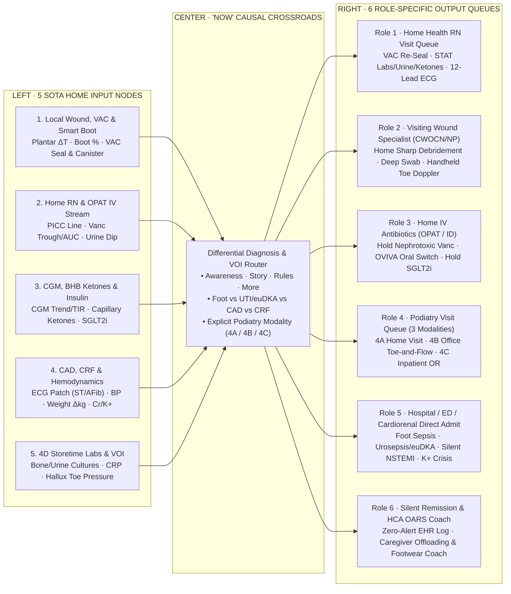

# SOTA Home Diabetic Mellitus Wound Care & Multimorbidity Spatial Router (`Home_DM_Wound_Care`)

**A Bounded 3D Spatial Clinical Router (`visionOS 27.0`) for Post-Discharge Home Diabetic Foot Salvage, NPWT/Wound VAC, Home IV Antibiotics (`OPAT` / `OVIVA`), 3-Tier Podiatry Visit Modalities, and High-Risk Multimorbidity Surveillance (`Sepsis` · `Occult UTI / euDKA` · `Silent CAD` · `CRF`)**  
**Authors & Credits:** Wayne Satz & **Google Science Program** (Research & Systems Architecture Collaboration)

[](#4-step-by-step-setup-execution--reproducibility-guide)
[](#4-step-by-step-setup-execution--reproducibility-guide)
[](PAPER/MANUSCRIPT_PHA_SALVAGE_BRIDGE.md)
[](#1-sota-clinical-foundation-home-diabetic-foot-care--high-risk-multimorbidity)
[](https://www.nature.com/articles/s41586-026-11161-8)
[](#2-bounded-3d-spatial-architecture-5-home-input-nodes--now-crossroads--6-role-output-queues)

> **🌐 Flagship Bounded 3D Spatial Workspace (`Port 8790`):** [**`src/pha_salvage_bridge/static/workspace.html`**](src/pha_salvage_bridge/static/workspace.html) (`http://127.0.0.1:8790/workspace` · GitHub Pages mirror at [**`docs/index.html`**](docs/index.html))  
> **✨ 3D Architecture Showpiece Landing Page:** [**`src/pha_salvage_bridge/static/landing.html`**](src/pha_salvage_bridge/static/landing.html) (`http://127.0.0.1:8790/landing` · GitHub Pages mirror at [**`docs/landing.html`**](docs/landing.html))  
> **📝 Academic Preprint (`IMRaD` Format, PDF & arXiv Bundle):** [**`PAPER/MANUSCRIPT_PHA_SALVAGE_BRIDGE.md`**](PAPER/MANUSCRIPT_PHA_SALVAGE_BRIDGE.md) · [**`PAPER/arxiv_submission/main.pdf`**](PAPER/arxiv_submission/main.pdf)  
> **🤝 Sibling Repositories:** [**`deesatzed/Home_DM_Wound_Care`**](https://github.com/deesatzed/Home_DM_Wound_Care) (this showpiece) · [**`deesatzed/spatial-clinical-router`**](https://github.com/deesatzed/spatial-clinical-router) · [**`deesatzed/personal-health-agent-bridge`**](https://github.com/deesatzed/personal-health-agent-bridge)

---

## Table of Contents

1. [SOTA Clinical Foundation: Home Diabetic Foot Care & High-Risk Multimorbidity](#1-sota-clinical-foundation-home-diabetic-foot-care--high-risk-multimorbidity)
2. [Bounded 3D Spatial Architecture: 5 Home Input Nodes $\rightarrow$ `NOW` Crossroads $\rightarrow$ 6 Role Output Queues](#2-bounded-3d-spatial-architecture-5-home-input-nodes--now-crossroads--6-role-output-queues)
3. [Curated 12-Case SOTA Home Diabetic Foot & Multimorbidity Cohort (`HDFU-01` .. `HDFU-12`)](#3-curated-12-case-sota-home-diabetic-foot--multimorbidity-cohort-hdfu-01--hdfu-12)
4. [Step-by-Step Setup, Execution & Reproducibility Guide](#4-step-by-step-setup-execution--reproducibility-guide)
5. [Underlying 4D `storetime` & Multi-Agent Empirical Benchmark (`N = 160`)](#5-underlying-4d-storetime--multi-agent-empirical-benchmark-n--160)
6. [Repository Structure](#6-repository-structure)

---

## 1. SOTA Clinical Foundation: Home Diabetic Foot Care & High-Risk Multimorbidity

Patients discharged home after hospitalization for **Diabetic Foot Ulcers (DFU)**, **Diabetic Foot Infections (DFI)**, **osteomyelitis (DFO)**, or **minor ray/transmetatarsal amputations** experience ~30% 30-day readmission rates. Synthesizing **2023–2026 IWGDF / IDSA / SVS guidelines**, **OVIVA trial stewardship**, and **Personal Health Agent (PHA)** telemetry (`doi:10.1038/s41586-026-11161-8`), `Home_DM_Wound_Care` addresses the two intersecting clinical failure modes in this population:

### 1.1 Local Foot, Offloading, NPWT (Wound VAC) & OPAT IV Antibiotic Streams
- **Plantar Dermal Thermometry + Smart-Boot Adherence:** Contralateral plantar temperature asymmetry $\Delta T \ge 2.2^\circ\text{C}$ ($4.0^\circ\text{F}$) over 48 hours reduces recurrent plantar ulceration by up to 70%, but isolated thermal spikes generate false positives unless fused with **smart-walker weight-bearing adherence (%)**, **daily wound photography**, and **exudate character**.
- **Home Negative Pressure Wound Therapy (NPWT / Wound VAC):** Continuous loss of vacuum seal ($>2\text{ hours}$ at $0\text{ mmHg}$) converts foam dressings into wet, macerating plugs and requires a **Home Health RN visit within 2–4 hours** (`HDFU-05`), whereas purulent or frank hemorrhagic canister shifts require urgent surgical evaluation (`HDFU-01`).
- **Home IV Antibiotics (`OPAT`) & `OVIVA` Oral Switch Stewardship:** Post-discharge DFO patients commonly receive 4–6 weeks of PICC/Midline IV therapy (Vancomycin, Daptomycin, Cefepime, Ertapenem). `Home_DM_Wound_Care` guards against **OPAT Vancomycin nephrotoxic AKI-on-CRF** (`HDFU-03`) and proactively identifies stable patients eligible for **PICC-to-oral transition (`OVIVA` criteria)** to eliminate catheter-related bloodstream infection (CLABSI) and DVT risk (`HDFU-11`).
- **Value-of-Information (`VOI`) Perfusion Gate (`Unavailable != Negative`):** Because medial arterial calcification (Mönckeberg's sclerosis) falsely elevates brachial ABI ($>1.30$) in $>50\%$ of diabetic limb patients, the router prioritizes **portable handheld PPG Hallux Toe Pressure ($\text{TP}$) / Toe-Brachial Index ($\text{TBI}$)** before escalating stalled wounds (`HDFU-06`).

### 1.2 High-Risk Multimorbidity Surveillance (`Sepsis` · `UTI / euDKA` · `Silent CAD` · `CRF`)

| Multimorbidity Domain | Pathophysiologic Vulnerability in Home DFU Patients | SOTA Home Telemetry Signature | Clinical Routing Distinction |
| :--- | :--- | :--- | :--- |
| **1. Normothermic Sepsis (Foot vs. Non-Foot)** | Advanced CKD and diabetes blunt classic fever ($>40\%$ present normothermic). Early sepsis manifests as **stress hyperglycemia ($\text{CGM} > 260\text{ mg/dL}$)**, **RHR jump**, **HRV collapse**, and **hypotension**. | `CGM Velocity Surge` + `RHR > 95 bpm` + `HRV < 18 ms` + `SBP < 100 mmHg` ± `Plantar ΔT / Purulent VAC` | Separates **Ascending Necrotizing Foot Sepsis** (`HDFU-01`, needing direct Inpatient OR I&D) from **Non-Foot Sepsis** (`HDFU-02`, where the foot is cool/quiet). |
| **2. Occult UTI / Urosepsis & SGLT2i Euglycemic DKA** | **Diabetic autonomic cystopathy** (incomplete bladder emptying) + **SGLT2 inhibitors** (empagliflozin/dapagliflozin glycosuria) drive complicated UTIs and **euglycemic DKA (`euDKA`)** during infection stress. | `Quiet Foot (ΔT < 1.0°C)` + `Confusion / Tachypnea` + `Home Dipstick Nitrite/LE (+)` + `Capillary Blood Ketones BHB >= 1.5 mmol/L (even with BG < 220 mg/dL)` | Routes to **Direct Medical Admit for euDKA/Urosepsis + Hold SGLT2i** (`HDFU-02`)—sparing the quiet surgical foot from an unnecessary OR exploration. |
| **3. Coronary Artery Disease (`CAD`) & Silent Ischemia** | **Cardiac Autonomic Neuropathy (CAN)** denervates pain fibers: **$>40\%$ of diabetic MIs occur without chest pain**, triggered by post-op anemia and heavy offloading boot exertion. | `Normoglycemic Cold Diaphoresis / Dyspnea` + `Wearable ECG Patch Horizontal ST-Depression (-1.8 mm) or New Rapid AFib` + `Orthostatic SBP Drop` | Routes immediately to **Direct Cardiology / ED Escalation + Home RN 12-Lead ECG** (`HDFU-04`) and halts planned outpatient debridement. |
| **4. Chronic Renal Failure (`CRF`) & Cardiorenal Edema** | Dual hazard: **(a) OPAT Vancomycin AKI-on-CRF** with hyperkalemia ($\text{K}^+ > 5.5\text{ mEq/L}$); **(b) Cardiorenal Venous Congestion** ($+2.4\text{ kg}$ weight gain causing bilateral pedal edema that splits foot sutures). | `Serum Cr / eGFR / K+` + `Vancomycin Trough/AUC` + `Bluetooth Scale Δkg` + `Spot Urine Sodium (UNa > 70 vs < 30 mmol/L)` | Separates **True Nephrotoxic AKI** ($\text{U}_{\text{Na}} 24$, hold Vancomycin, `HDFU-03`) from **Congestive Suture Hazard with Permissive Hypercreatininemia** ($\text{U}_{\text{Na}} 84$, continue diuresis, `HDFU-09`). |

---

## 2. Bounded 3D Spatial Architecture: 5 Home Input Nodes $\rightarrow$ `NOW` Crossroads $\rightarrow$ 6 Role Output Queues



### Explicit 3-Tier Podiatry Visit Modality Routing (`Role 4`)
Every case involving Podiatry explicitly specifies **which clinical visit setting is required and why**:
- **`Modality 4A · Podiatry Home / Tele-Co-Visit`** (paired with Visiting Wound Specialist): For homebound/wheelchair patients needing bedside sharp callus paring (`HDFU-07`) or dorsal suture-tension review (`HDFU-09`) without traumatic ambulance transport.
- **`Modality 4B · Podiatry Office Visit ("Toe-and-Flow" 24–48h Hot-Foot Clinic)`**: When clinic-only equipment is mandatory—**weight-bearing digital foot radiographs**, sterile **Probe-to-Bone (PTB)**, **non-removable Total Contact Cast (`TCC-EZ`)** application (`HDFU-08`), or joint **Vascular Arterial Duplex** (`HDFU-06`).
- **`Modality 4C · Inpatient Podiatry / Vascular Surgical Consult`**: Paired with Direct Hospital Admission when urgent operating-room incision & drainage (I&D) or deep debridement is required (`HDFU-01`).

---

## 3. Curated 12-Case SOTA Home Diabetic Foot & Multimorbidity Cohort (`HDFU-01` .. `HDFU-12`)

| Case ID | Clinical Archetype & Multimorbidity | Key 5-Node Home Telemetry | Primary Output Role Queue & Podiatry Modality |
| :--- | :--- | :--- | :--- |
| **`HDFU-01`** | **Normothermic Ascending Plantar Abscess & Foot Sepsis** (`CKD 3b`) | Plantar $\Delta T +3.1^\circ\text{C}$, purulent VAC canister, CGM $142 \rightarrow 288\text{ mg/dL}$, RHR $104\text{ bpm}$, HRV $14\text{ ms}$, BP $98/60$, temp $37.1^\circ\text{C}$, Urine Dip $(-)$ | **`Role 5 · Hospital Direct Admit`** + **`Modality 4C · Inpatient Podiatry OR I&D`** |
| **`HDFU-02`** | **Occult Urosepsis & SGLT2i Euglycemic DKA Mimicking Foot Sepsis** | **Foot Quiet ($\Delta T +0.4^\circ\text{C}$)**, confusion, HR $98$, RR $24$, Urine Nitrite/LE $(+)$, **Capillary Ketones $\text{BHB } 2.6\text{ mmol/L}$** at BG $204\text{ mg/dL}$ on Empagliflozin | **`Role 5 · Hospital Direct Admit (euDKA/Urosepsis)`** + **`Role 3 · OPAT Hold SGLT2i`** *(Spares foot OR)* |
| **`HDFU-03`** | **OPAT IV Vancomycin Nephrotoxic AKI-on-CRF (`Stage 4 CKD`)** | PICC Vanc trough **$26.4\text{ }\mu\text{g/mL}$** ($\text{AUC } 690$), $\text{Cr } 1.8 \rightarrow 2.9\text{ mg/dL}$ ($\text{eGFR } 19$), **$\text{K}^+ 5.8\text{ mEq/L}$**, Spot $\text{U}_{\text{Na}} 24\text{ mEq/L}$ | **`Role 3 · OPAT Hold Vanc & Switch to Oral Linezolid`** + **`Role 1 · Home RN STAT ECG/BMP`** |
| **`HDFU-04`** | **Silent CAD / NSTEMI from Post-Op Anemia & Boot Exertion** | Zero chest pain (CAN), cold diaphoresis + dyspnea, normoglycemic ($164\text{ mg/dL}$), ECG patch **$-1.8\text{ mm}$ ST-depression**, orthostatic SBP $138 \rightarrow 96\text{ mmHg}$ | **`Role 5 · Direct Cardiology/ED Admit`** + **`Role 1 · Home RN 12-Lead ECG`** *(Holds debridement)* |
| **`HDFU-05`** | **Mechanical NPWT (Wound VAC) Continuous Seal Leak ($3.5\text{h}$)** | VAC pressure $0\text{ mmHg}$ for $3.5\text{h}$, periwound white maceration rim, serous canister, afebrile, CRP $42 \rightarrow 14\text{ mg/L}$ | **`Role 1 · Home RN Urgent 2h Visit (Hydrocolloid VAC Re-Seal)`** + **`Role 2 · CWOCN Photo Co-Sign`** |
| **`HDFU-06`** | **Stalled Midfoot Ulcer with Unmeasured Perfusion VOI (`ABI 1.44`)** | $<8\%$ wound contraction at Week 3 despite $91\%$ boot adherence; calcified inpatient $\text{ABI } 1.44$; **Hallux Toe Pressure unmeasured** | **`Role 2 · Visiting Wound Specialist (Handheld PPG Hallux TP VOI)`** + **`Modality 4B · Office Duplex`** |
| **`HDFU-07`** | **Homebound Wheelchair Patient Needing Sharp Callus Debridement** | Hyperkeratotic callus ring + $\Delta T +2.2^\circ\text{C}$, $94\%$ offloading adherence, verified $\text{TP } 54\text{ mmHg}$, severe osteoarthritis | **`Role 2 · Visiting Wound Specialist (Bedside Sharp Debridement)`** + **`Modality 4A · Podiatry Home Tele-Co-Visit`** |
| **`HDFU-08`** | **Removable Boot Non-Adherence ($46\%$) & Suspected Deep Sinus** | Boot wear $46\%$ ($4,900$ steps), plantar $\Delta T +2.7^\circ\text{C}$, deeper ulcer crater, ambulatory, intact $\text{TP } 58\text{ mmHg}$ | **`Modality 4B · Podiatry Office 24h Visit (PTB, Weight-Bearing X-Ray & TCC-EZ Cast)`** |
| **`HDFU-09`** | **Cardiorenal $+2.4\text{ kg}$ Edema Threatening Suture Line ($\text{U}_{\text{Na}} 84$)** | Bilateral $2+$ pitting edema stretching dorsal sutures, $\text{Cr } 1.55 \rightarrow 1.84\text{ mg/dL}$ with **brisk Spot $\text{U}_{\text{Na}} 84\text{ mmol/L}$** (permissive hypercreatininemia) | **`Role 1 · Home RN Decongestive Torsemide & Safe Compression`** + **`Modality 4A · Suture Tele-Check`** |
| **`HDFU-10`** | **Post-DFI Insulin Sensitivity Rebound Driving 03:15 AM Hypo ($54\text{ mg/dL}$)** | Infection CRP resolved ($62 \rightarrow 9\text{ mg/L}$), 03:15 AM CGM $54\text{ mg/dL}$ on discharge glargine, walking unbooted in dark, left heel $\Delta T +2.3^\circ\text{C}$ | **`Role 1 · Home RN Live Rescue & $-20\%$ Basal Protocol`** + **`Role 6 · Bedside Glucose & Shoe Lift`** |
| **`HDFU-11`** | **Week-2 Osteomyelitis Eligible for `OVIVA` PICC IV-to-Oral Switch** | $64\%$ wound contraction, $\text{CRP } 68 \rightarrow 11\text{ mg/L}$, bone biopsy susceptible to oral Levofloxacin + Rifampin, PICC site dermatitis | **`Role 3 · OPAT/ID Authorize OVIVA Oral Switch`** + **`Role 1 · Home RN Remove PICC Line Today`** |
| **`HDFU-12`** | **Day-21 Granulation Benchmark & Custom Footwear Graduation** | Complete epithelialization, $\Delta T +0.3^\circ\text{C}$, boot $95\%$, CGM TIR $91\%$, normal sinus ECG, $\text{Cr } 1.12\text{ mg/dL}$, $\text{TP } 60\text{ mmHg}$ | **`Role 6 · Silent Remission EHR Log & Custom Diabetic Footwear Graduation`** *(Zero clinician alert)* |

---

## 4. Step-by-Step Setup, Execution & Reproducibility Guide

### 4.1 Prerequisites & Zero-Dependency Design
- **Operating System:** macOS, Linux, or Windows (WSL2).
- **Python Version:** **Python `3.10+`** (tested on Python `3.10` through `3.15`).
- **External Dependencies:** **None (`0` third-party packages required).** Runs 100% on the Python standard library.

### 4.2 Clone & Launch the Bounded 3D Spatial Workspace (`Port 8790`)
```bash
git clone https://github.com/deesatzed/Home_DM_Wound_Care.git
cd Home_DM_Wound_Care
python3 src/pha_salvage_bridge/server.py
```
Open your browser to:
- **Flagship Bounded 3D Spatial Workspace (`HDFU-01..12`):** [`http://127.0.0.1:8790/workspace`](http://127.0.0.1:8790/workspace) (also served at [`http://127.0.0.1:8790/`](http://127.0.0.1:8790/))
- **3D Architecture Showpiece Landing Page:** [`http://127.0.0.1:8790/landing`](http://127.0.0.1:8790/landing)
- **Cohort Metadata JSON API:** [`http://127.0.0.1:8790/api/home_dm_cohort`](http://127.0.0.1:8790/api/home_dm_cohort)

### 4.3 Run the Automated Test Suite & Manuscript Consistency Auditor
```bash
# 1. Run the 7-test unit & integration suite
PYTHONPATH=src python3 -m unittest discover -s tests -v

# 2. Run the automated benchmark-to-manuscript consistency auditor
python3 scripts/verify_pha_manuscript.py
```

---

## 5. Underlying 4D `storetime` & Multi-Agent Empirical Benchmark (`N = 160`)

### 5.1 Outpatient `charttime` vs. `storetime` Temporal Leakage Audit (`Day 7 Landmark, t_k = 168.0h`)

| Evaluation Protocol | Timestamp Filter Applied at $t_k = 168.0\text{h}$ | 30-Day Readmission / Relapse AUROC | Optimistic Leakage Inflation ($\Delta\text{AUROC}$) | Delayed Outpatient Labs Masked (%) |
| :--- | :--- | :---: | :---: | :---: |
| **Strict 4D State Lock (`PHA × SALVAGE-AI`)** | $t_{\text{store}}(e_i) \le 168.0\text{h}$ | **`0.8110`** | Baseline (Zero Leakage) | **`100.0%`** |
| **Naive Retrospective Join (`Leaked charttime`)** | $t_{\text{chart}}(e_i) \le 168.0\text{h}$ | `1.0000` | **`+0.1890`** | `0.0%` |

### 5.2 Three-Arm Architecture Comparison ($N = 160$: $n = 80$ `POST_DFI_SALVAGE` + $n = 80$ `POST_SEPSIS_CARDIORENAL`)

| Architectural Arm | Exposed to Outpatient `charttime` Leakage? | Missing-Workup Top-3 VOI Recall@3 | Unidentifiable Causal Claims Blocked (%) | Unsafe Lifestyle Coaching During Acute Flare (%) |
| :--- | :---: | :---: | :---: | :---: |
| **Arm 1: Monolithic Ungated LLM** | Yes (`Leaked`) | `0.4562` (`45.6%`) | `0.0%` | `34.0%` |
| **Arm 2: Standard 3-Agent PHA (No `SALVAGE` Guards)** | Yes (`Leaked`) | `0.6875` (`68.8%`) | `0.0%` | `12.5%` |
| **Arm 3: Bidirectional `PHA × SALVAGE-AI` Bridge** | **No (`storetime` Locked)** | **`1.0000` (`100.0%`)** | **`100.0%`** | **`0.0%`** |

### 5.3 Apple Vision Pro (`visionOS 27.0`) Spatial Crossroads & `M0–M5` Symbiosis Gate Performance

| Spatial / Clinical Gate Metric | Value | Architectural Significance |
| :--- | :---: | :--- |
| **Target Spatial Platform** | `visionOS 27.0` / `iPadOS 27.0` | 5 Home Input Nodes $\rightarrow$ `NOW` Crossroads $\rightarrow$ 6 Role Task Queues + `M0–M5` Symbiosis Gate |
| **Spatial Rendering Frame Budget** | **`90.0 Hz`** | Stereoscopic `NowCard` + Role Task Queue spoke rendering budget |
| **Kenyon-Cell Sparsity (`APL k-WTA`)** | **`95.0%`** ($12 / 240$ active) | Prevents feature collision between consumer wearables and missing EHR indicators |
| **Gate Inference Latency per Sync** | **`0.68 ms`** | Sub-millisecond spatial gate evaluation prior to clinician `NowCard` interruption |
| **M2 Earned-Autonomy Safety Caps** | **`Autonomy <= 40%` / `Deference >= 80%`** | Hard clinical safety bounds preventing runaway autonomous prescription or escalation |
| **Routine Benign Syncs Suppressed** | **`100.0%`** | All stable recovery syncs suppressed from provider interrupt |
| **Clinical Red-Flag Wake Sensitivity** | **`100.0%`** | Zero missed acute thermal, OPAT nephrotoxic, uroseptic/euDKA, or silent ischemic flares |

---

## 6. Repository Structure

```text
Home_DM_Wound_Care/
├── README.md
├── docs/
│   ├── index.html                                 # GitHub Pages Bounded 3D Spatial Workspace (HDFU-01..12)
│   └── landing.html                               # GitHub Pages 3D Showpiece Architecture Overview
├── PAPER/
│   ├── MANUSCRIPT_PHA_SALVAGE_BRIDGE.md           # Full companion academic manuscript
│   └── arxiv_submission/                          # Ready-to-upload arXiv LaTeX bundle & compiled PDF
├── data/
│   └── pha_salvage_bidirectional_benchmark.json   # N=160 post-discharge benchmark & flagship scenarios
├── scripts/
│   └── verify_pha_manuscript.py                   # Automated benchmark-to-manuscript consistency auditor
├── src/
│   └── pha_salvage_bridge/
│       ├── __init__.py
│       ├── models.py                              # 4D Time-Locked Wearable + Outpatient EHR State
│       ├── vision_pro_spatial_gate.py             # Apple Vision Pro (visionOS 27.0) Spatial Crossroads Gate
│       ├── agents.py                              # DSA + DEA + HCA + Fail-Closed NowCard Orchestrator
│       ├── benchmark.py                           # N=160 3-Arm Post-Discharge Evaluation Engine
│       ├── server.py                              # Standalone HTTP Server & REST API (Port 8790)
│       └── static/
│           ├── workspace.html                     # Flagship 5-Input -> NOW -> 6-Role Spatial Workspace
│           └── landing.html                       # 3D Architecture Showpiece Landing Page
└── tests/
    └── test_pha_salvage_bridge.py                 # 7-test verification suite (including 12-case HDFU audit)
```
